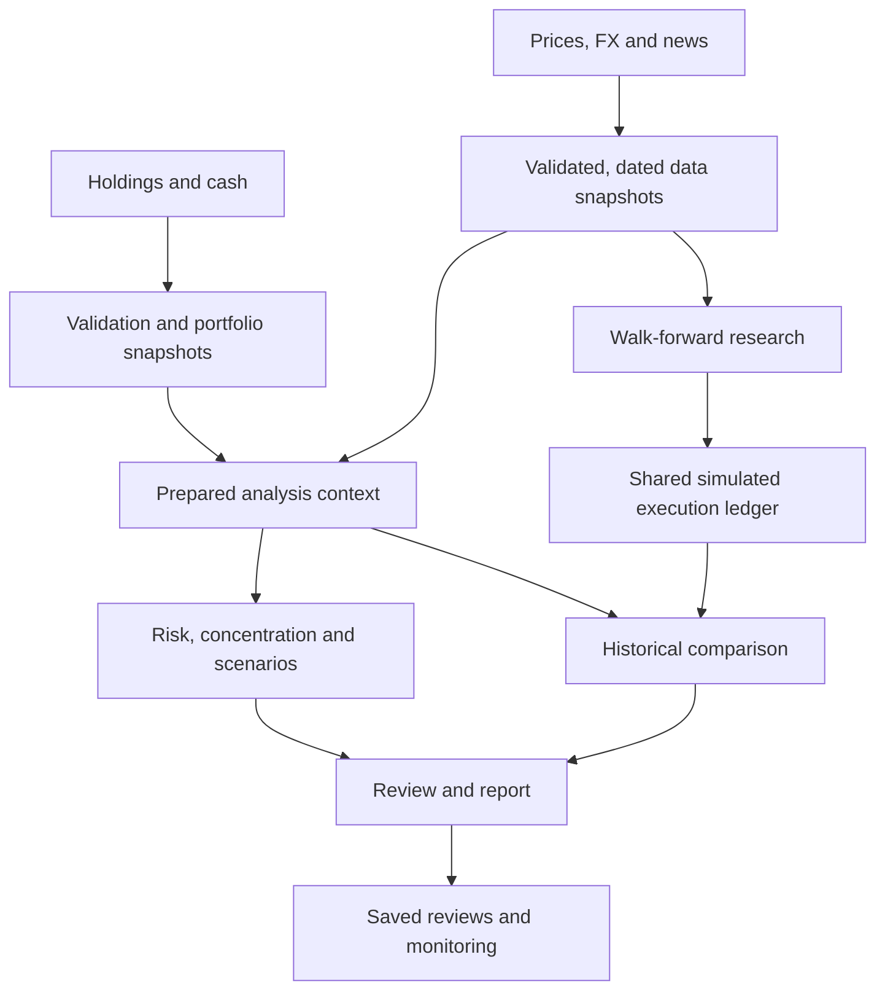
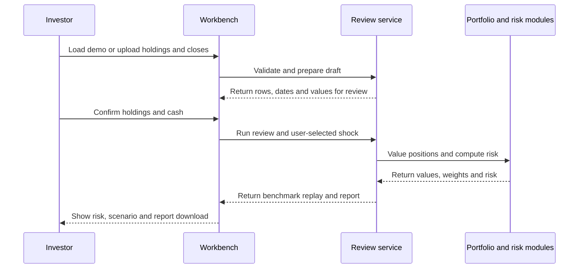

# Portfolio Workbench

## What, why and how

Portfolio Workbench helps a self-directed investor review an existing portfolio, compare a proposed change and keep the evidence behind that review. The first audience is a person holding listed shares, ETFs and cash who reviews the account after a statement, earnings week or material market move. Their primary questions are: what exposure do I have, what would a scenario do to that exposure, and how does an alternative behave under the same assumptions?

An investor currently has to transfer broker balances to a spreadsheet, gather price history, compute weights, and remember the assumptions behind a chart. We combine the holdings, risk, scenario and research views around the same portfolio and dated data. An investor can compare a holding mix with a benchmark even if a news feed or model is unavailable. Research later answers whether a rule added value after costs and on unseen periods. News is context for an exposure. Model scores are evidence for a research experiment, separate from observed facts and user decisions.

Example journey. A user exports holdings, maps ambiguous rows, confirms shares and cash against the statement and inspects the largest exposure. The report shows how a 15% shock to a position would affect the whole portfolio. The user compares a cash-matched equal-weight baseline over a common window, then exports the report with dates and assumptions. In later releases, the user can review changes since the last snapshot, read relevant sourced headlines and inspect whether a sentiment rule survived measured costs and walk-forward evaluation.

The product has three surfaces. **Review** shows holdings, data quality, concentration, VaR and expected shortfall, stress and snapshot comparisons. **Research** compares user-defined and benchmark strategies through a common execution ledger and later runs price-versus-news experiments. **Monitor** explains changed exposures, upcoming events and user-defined risk thresholds, with an evidence trail and delivery preferences. The three surfaces share instrument identities, valuations and market snapshots.

## Source audit

| Source | Verified starting point | Integration decision |
| --- | --- | --- |
| Quant Risk Platform at `d51f737` | FastAPI, Streamlit, Decimal holdings, cash-aware risk, lognormal Monte Carlo, checked optimisation and crisis replay | Keep existing contracts and analytics. Add the workbench beside the legacy UI and migrate existing risk modules into the new workflow as each receives a shared prepared context. |
| NewsAlpha at `e85e401` | Repo contains configuration and blank baseline, engine and metrics files. Supplied description documents a previous price ingestion exercise and the target design. | Implement the execution and research layers here. Treat FinBERT, supervised learning and PPO as planned research. |
| Additional product features | Account workspace, recurring review, alerts and logs | Build these only when validated by a repeat-use workflow and required privacy/data infrastructure. |

## Requirements and acceptance

| ID | User outcome | Requirement and acceptance proof | Phase |
| --- | --- | --- | --- |
| R01 | Bring in a portfolio | Validate a bounded UTF-8 holdings CSV, stable exchange-qualified identifier, positive fractional quantity and explicit base-currency cash. Show row-specific errors and reject duplicates, unsupported exchanges and mixed currencies. User sees all valid rows and confirms before analysis. | 1 |
| R02 | Know how it was valued | Use exact quantities and cash, latest imported close per asset, and the same dated series in the analytics. Show price date, source, imported currency, as-supplied status and input fingerprints. Reordered rows preserve calculated results and the price-panel fingerprint. Snapshot IDs include confirmation time and source row provenance. Later resolve symbols, validate source/date freshness and reconcile broker totals. | 1–2 |
| R03 | Understand exposures | Position and cash weights reconcile to total equity. Display 95% one-session historical VaR and expected shortfall, observation count and concentration. Incomplete inputs block instead of dropping assets. Add Monte Carlo, crisis windows and correlation on the shared context after this slice. | 1–2 |
| R04 | Compare a change | User selects one held instrument and an instantaneous signed shock. Show shocked equity and P&L, preserve cash, and validate the result by hand. Later add multi-asset, factor and FX scenarios and side-by-side saved snapshots. | 1–2 |
| R05 | Compare an alternative fairly | Run a fixed-holdings exposure replay and a cash-matched equal-weight buy-and-hold comparator on the identical closing-price panel. Seed both with equal value. Distinguish hypothetical current exposures applied to past data and actual historical accounts. | 1 |
| R06 | Analyse historical strategy decisions | Use a shared execution ledger for holding state, fees, fills, slippage, drift and cash. Compare buy-and-hold, scheduled equal-weight, momentum and cash; pass hand reconciliations of orders and timing. Show out-of-sample metrics, drawdown, costs, turnover and ledgers. | 3 |
| R07 | Understand relevant events | Link each event to source, instruments and publication/availability times. Distinguish conflicting reports, missing coverage and neutral sentiment. Deduplicate syndicated articles without increasing past availability. Prove after-cutoff exclusion and expose news coverage. | 4 |
| R08 | Test whether sentiment helped | Freeze price-only and price-plus-sentiment experiments with matched universe, folds, labels, engine and costs. Report incremental net value, fold dispersion, sensitivity, coverage and negative results. PPO enters after baseline and environment validation and is evaluated over multiple seeds. | 5 |
| R09 | Reproduce and share a review | Export inputs, dates, assumptions, exact report values and format version. Local slice has session review and JSON download. Saved reports later reference immutable dataset, configuration and engine versions. Verify authorised export and deletion. | 1, 6 |
| R10 | Return and monitor | Private accounts and snapshots, threshold rules, digest, duplicate suppression and delivery history. A failed refresh retains the last good data, shows staleness and never sends a threshold notification based on an incomplete run. | 6 |
| R11 | Import directly from a broker | Verify coverage for one broker and jurisdiction, use approved read-only authorisation, reconcile balances, maintain retry/disconnect/expiry semantics and prevent erroneous empty responses replacing holdings. CMC Invest requires its own coverage check. | 7 |
| R12 | Interpret a whole portfolio | Add FX to both valuation and historical returns, record direction and source, value foreign cash and align close times across exchanges. Verify a flat foreign asset with changing FX produces the expected base-currency return. | 7 |

For phase 1, one US or ASX market calendar and one USD or AUD currency apply per report. Prices are supplied by the user or generated for an offline demo. This is a holdings snapshot CSV, not a trade ledger. A dated report can be produced with no broker account, market provider, secret or paid model. Report integrity and privacy are release gates. The local app keeps data in the Streamlit session and processes inputs in the same Python process. Avoid uploading private files to a hosted preview. The release gate for a public pilot includes licence review for market data, news, and model weights, and a review of the exact Australian product flows and claims with a qualified adviser. ASIC's [financial product advice guidance](https://www.asic.gov.au/regulatory-resources/financial-services/giving-financial-product-advice) and [RG 255](https://www.asic.gov.au/regulatory-resources/find-a-document/regulatory-guides/rg-255-providing-digital-financial-product-advice-to-retail-clients) are inputs to that assessment. Product scope is retrospective analytics, user-defined scenarios and evidence, with no order submission or personalised recommended trades.

## Architecture and boundaries

Start with a Python modular monolith. Phase 1 uses an in-process application service from a separate Streamlit entry point, which permits local processing and direct tests. The existing FastAPI and Streamlit entry points continue serving the old dashboard. Introduce authenticated FastAPI operations only when the saved workspace is ready. Use PostgreSQL for ownership and transactional metadata. Use object storage for private artefacts and rights-approved versioned market panels. Add a durable worker for ingestion, research and refresh once these exceed synchronous budgets. Choose hosting and model providers after measuring cost and checking rights. The API can remain small because research deployments carry separate ML extras.

| Boundary | Responsibility | Inputs to remember |
| --- | --- | --- |
| `src/domain` | Existing immutable instrument, holding and valuation records | Authority and quote provenance are distinct from identity |
| `src/workbench/inputs.py` | Parse bounded holdings and historical-close files, align by instrument ID, validate market/currency coverage | Exact schemas, errors with line numbers, consistent date panel, dataset digest |
| `src/workbench/review.py` | Prepare a review, derive weights with the domain valuation, call the risk engine and compare historical exposures | Valuation date, data fingerprint, cash policy, analytics methodology version |
| `src/workbench/demo.py` and `src/ui/workbench.py` | Offline demo, upload and review, confirm, scenario, export | Clear synthetic/user-supplied source label and session ownership |
| Future `market_data` and `news` | Resolve instruments, fetch approved feeds, align market calendars and enforce as-of contracts | Instrument IDs, observation/session, available time, revision, adjustment policy, checksum |
| Future `research` | Dataset manifests, features, split plans, execution ledger, metrics, experiment results | Configuration, windows, labels, seed, data version, cost and timing rules |
| Future `storage` and `workers` | Tenant boundaries, refresh, bounded jobs, idempotency, retries and exports | Verified owner, immutable object refs, leases, attempts and error categories |

Portfolio snapshot records instrument IDs, quantities, base currency, cash and the user confirmation timestamp. A valuation references the price snapshot used. A price record has instrument ID, market session and close; live adapters also record source and availability timestamps. A review result references inputs, assumptions and method version. A future experiment adds frozen universe, features, time splits, seeds, cost settings and ledger references. A current market valuation uses appropriate unadjusted quotes with matching units. Historical research must explicitly choose raw prices plus corporate-action ledger, or a documented adjusted-unit convention. It must never credit the same dividend twice.

## Research timing and evaluation design

1. Record provider publication time, first observed time, retrieval time and corrections separately. A record becomes eligible at its effective availability time. Historical feeds without credible availability evidence carry a separate quality label and are excluded from strong point-in-time claims.
2. Build features by declared market calendar and cutoff, e.g. after session close, then simulate execution at the next eligible open. A newly opened position earns returns only from its fill onward. Existing positions earn the prior close-to-open move. Carry cash and shares forward across sessions.
3. The accounting service processes sells before buys and explicitly budgets fees and slippage. Apply position limits to executable allocations and surface partial fills or untradable assets. Maintain cash, quantities, trade notional, costs and marked wealth. Use the same engine for every model and benchmark.
4. Use expanding or rolling training, validation and held-out test windows. Purge labels whose executable outcomes overlap the split. Fit preprocessing on training windows. Compare regularised supervised models with the same target, allocation rule and costs first. Track search attempts and report cost sensitivity, dispersion, drawdown and turnover.
5. Evaluate pretrained FinBERT only once rights and dataset coverage are verified. Track model revision and article fingerprint; cache per article. Distinguish no coverage from neutral content. Supplied NewsAlpha's phase order is preserved. Use PPO against the validated ledger only after price, momentum and sentiment benchmarks exist. Run multiple seeds and publish an inconclusive result when evidence is weak.

## Implementation and verification sequence

| Step | Build | Stop-and-review gate |
| --- | --- | --- |
| 1 | Ship a separate local workspace, downloadable templates, offline example, holdings/close CSV validation, valuation preview, risk cards, cash-matched replay, one-position shock and export. | Independent calculation test; invalid input tests; app confirmation, export and reset smoke; existing test suite; feature-branch CI. |
| 2 | Add instrument resolver and approved quote adapter with sample US and AU holdings; record stale coverage and bring over the existing risk charts, simulations and crisis replay behind one prepared context. | Contract fixtures for missing/ambiguous listings, date and adjustment handling, typed unavailable domains, fresh and stale cases, request latency/load budget. |
| 3 | Build NewsAlpha’s execution ledger, baseline rules, replay reports and metrics. | Verify no look-ahead, total wealth identity, costs, turnover, trade sizing, missing prices, and hand-calculated gap/timing examples. |
| 4 | Add timestamped event ingestion and entity linking, then cached sentiment if eligible. | Manual audit of attribution and duplicate clusters, availability cutoff fixtures, provider rights and coverage. |
| 5 | Add chronological supervised experiments, sentiment ablation and then optional PPO. | Repeatability from manifests, leaked-feature injection test, same-fold/same-cost ablation, multiple seeds and visible documented failures. |
| 6 | Add private workspace, durable jobs, report diff and opt-in alerts. | Cross-account isolation needs denial at every list/read/write/export route, replay of same idempotency key, recovery from worker failure, backup restore and delivery deduplication. |
| 7 | Add AUD/USD history and one vetted broker. | Known-answer FX/cash tests, revoked access, retries, freshness and reconciliation. Verify jurisdiction-specific data rights before beta. |

During the pilot, measure successful first reviews with eligible files, time to complete a review and whether users can explain their largest exposure and the scenario outcome. Recruit a small cohort and compare their existing spreadsheet process. Establish baseline measurements before setting targets. For operations, measure request duration and failure categories without logging positions or raw uploads. Pin a resource and payload budget before making analytics jobs public. Ship each phase in a small GitHub PR with an acceptance checklist, smoke evidence and a migration/rollback note where relevant.

## Product decisions to revisit with evidence

The first workspace is local and session-scoped, with a downloadable record and no account setup. This tests the workflow before designing a database. A separate entry point keeps the current app available while the workspace changes. It is acceptable to replace Streamlit if user testing shows that account or navigation workflows require a different web interface, with the same domain contracts and services. A retained synthetic demo is useful for deterministic evaluation and onboarding. News ingestion and broker connectivity depend on confirmed data availability, rights and supported account types. Model accuracy and net performance are empirical questions with no promised uplift.

## Phase 1 methods and limitations

Provide a holdings CSV and a long-form historical close CSV. Use ordinary closing prices in major currency units, adjusted only if independently appropriate for the comparison. Phase 1 does not model corporate actions, fees, trading, calendar completeness or actual account returns. The validator checks matching observed dates among assets, positive closes and at least 252 return observations. It cannot detect a trading date omitted from every input series. Upstream revisions and splits must be checked before interpreting results. Latest supplied close dates can be stale even when the panel is internally consistent. The UI and export show the observed date explicitly. The holdings file has no broker account identifiers, so listed instruments remain user-declared in this phase.

One-session historical VaR/ES applies valuation-date exposures to prior returns. Replay uses those present exposures as initial weights at the first supplied close, then lets fixed allocations drift. The equal-weight benchmark makes one equal allocation among the same held assets and uses the same cash weight, first close and panel. Both are hypothetical, start at 100, and report terminal return and peak-to-trough drawdown. A user-directed price shock is instantaneous and holds every other asset constant. Cash earns zero in these calculations. These three outputs answer different questions and the interface labels their separate assumptions.
